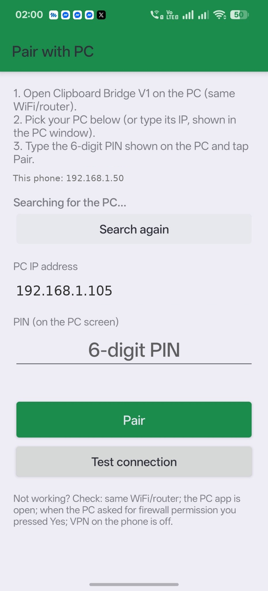
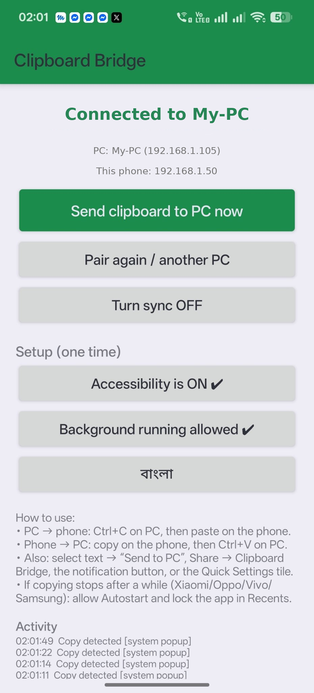
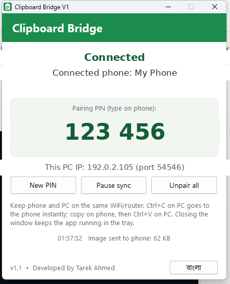

# Clipboard Bridge

[](https://github.com/bbsmbd/clipboard-bridge/releases)
[](LICENSE)

**Copy on your PC → paste on your Android phone. Copy on the phone → paste on the PC.**
Over your own WiFi, end-to-end encrypted, no cloud, no account.

পিসিতে কপি করলে ফোনে পেস্ট, ফোনে কপি করলে পিসিতে পেস্ট। একই WiFi/রাউটার লাগে। কোনো ক্লাউড, লগইন বা ইন্টারনেট লাগে না। সব লেখা AES-256 দিয়ে এনক্রিপ্ট হয়ে যায়।

[বাংলা নির্দেশিকা (Bengali guide)](README-bn.md)

---

## Download

From the [Releases](https://github.com/bbsmbd/clipboard-bridge/releases) page:

| File | What it is |
|---|---|
| `ClipboardBridge-V1-Setup.exe` | **Windows installer** (recommended): installs, adds Start menu/Desktop shortcuts, starts with Windows, uninstalls cleanly |
| `ClipboardBridge-V1.exe` | Portable Windows app (no install). Keep it in a fixed folder, since autostart remembers its location |
| `ClipboardBridge-V1.apk` | Android app v1.1.0 (Android 6 – 17) |

Requirements: Windows 10/11 64-bit · Android 6.0 or newer · PC and phone on the same WiFi/router.

### বাংলা

[Releases](https://github.com/bbsmbd/clipboard-bridge/releases) পাতা থেকে নামান:

| ফাইল | কী |
|---|---|
| `ClipboardBridge-V1-Setup.exe` | পিসির ইনস্টলার (সুপারিশকৃত): ইনস্টল, শর্টকাট, Windows-এর সাথে নিজে চালু, পরিষ্কার আনইনস্টল |
| `ClipboardBridge-V1.exe` | ইনস্টল ছাড়া চালানোর পিসি অ্যাপ (Windows 10/11, ৬৪-বিট)। একটা নির্দিষ্ট ফোল্ডারে রাখুন |
| `ClipboardBridge-V1.apk` | ফোন অ্যাপ v1.1.0 (Android 6 থেকে Android 17) |

লাগবে: Windows 10/11 ৬৪-বিট · Android 6.0 বা তার নতুন · পিসি আর ফোন একই WiFi/রাউটারে।

## Screenshots


*Pair with PC — enter the PC's IP and the 6-digit PIN shown on the PC.*


*Connected — copy on the PC, paste on the phone, and back.*


*The PC window — connected phone, pairing PIN and PC IP.*

> The IP addresses, PIN and device names in the screenshots are examples.

### বাংলা


*পিসির সাথে যুক্ত করুন — পিসির IP আর ৬ সংখ্যার পিন লিখুন।*


*যুক্ত হয়েছে — পিসিতে কপি করলে ফোনে পেস্ট, ফোনে কপি করলে পিসিতে পেস্ট।*


*পিসির উইন্ডো — যুক্ত ফোন, পেয়ারিং পিন আর পিসির IP।*

> ছবিতে দেখানো IP ঠিকানা, পিন আর ডিভাইসের নাম উদাহরণ মাত্র।

## Features

- **PC → phone:** Ctrl+C on the PC is on the phone's clipboard instantly.
- **Phone → PC:** copy on the phone, then Ctrl+V on the PC.
  - Android 6–9: automatic.
  - Android 10+: automatic with the app's Accessibility service turned on.
  - One-tap ways that always work:
    - "Send to PC" in the text-selection menu
    - Share → Clipboard Bridge
    - The notification button
    - The Quick Settings tile
- **Images too (both ways):**
  - Copy an image or take a screenshot on the PC (Win+Shift+S) → it is on the phone's clipboard, ready to paste in WhatsApp, Telegram, Gmail and other apps that accept pasted images. On Android 10+ it is also saved to Gallery → *Pictures/Clipboard Bridge*.
  - Copy an image on the phone, or use Share → Clipboard Bridge → it is on the PC clipboard, so Ctrl+V works in Word, Paint, WhatsApp Web and other apps. Up to 20 MB per image.
- **Finds the PC by itself:** a UDP beacon plus a subnet scan, so it still works when the router blocks broadcasts. It reconnects by itself when the PC's IP changes.
- **Secure:**
  - Pairing uses a 6-digit PIN with PBKDF2-SHA256 and a lockout after 5 wrong tries.
  - All traffic is encrypted with AES-256-GCM.
  - The key on the phone is protected by the Android Keystore.
- **Low maintenance:**
  - The PC app runs in the system tray and starts with Windows.
  - The phone keeps a foreground connection and reconnects after WiFi drops and reboots.
- **Languages:** English (default) and Bengali.

### বাংলা

- **পিসি → ফোন:** পিসিতে Ctrl+C করলে সাথে সাথে ফোনের ক্লিপবোর্ডে চলে যায়। ফোনে শুধু Paste করুন।
- **ফোন → পিসি:** ফোনে Copy করুন, তারপর পিসিতে Ctrl+V।
  - Android 6–9: পুরোপুরি স্বয়ংক্রিয়।
  - Android 10+: Accessibility চালু থাকলে Copy চাপার সাথে সাথে চলে যায়।
  - এছাড়াও যেকোনো সময় কাজ করে:
    - লেখা সিলেক্ট করে মেনুতে **"পিসিতে পাঠান"**
    - Share → Clipboard Bridge
    - নোটিফিকেশনের **"ক্লিপবোর্ড পিসিতে পাঠান"** বোতাম
    - Quick Settings টাইল
- **ছবি (দুই দিকেই):**
  - পিসিতে ছবি কপি করলে বা স্ক্রিনশট (Win+Shift+S) নিলে ফোনের ক্লিপবোর্ডে চলে যায়। WhatsApp, Telegram, Gmail-এর মতো যেসব অ্যাপ ছবি পেস্ট নেয় সেখানে পেস্ট করুন। Android 10+ এ গ্যালারির *Pictures/Clipboard Bridge*-এও সেভ হয়।
  - ফোনে ছবি Copy করলে, অথবা Share → Clipboard Bridge দিলে, পিসিতে Ctrl+V দিয়ে Word, Paint বা WhatsApp Web-এ বসানো যায়। প্রতিটা ছবি সর্বোচ্চ ২০ MB।
- **পিসি নিজে খুঁজে নেয়:** UDP beacon আর সাবনেট স্ক্যানের মাধ্যমে, রাউটার ব্রডকাস্ট আটকালেও কাজ করে। পিসির IP বদলালেও ফোন নিজে আবার যুক্ত হয়।
- **নিরাপদ:**
  - যুক্ত হতে ৬ সংখ্যার পিন লাগে (PBKDF2-SHA256), ৫ বার ভুল পিনে লক হয়।
  - সব লেখা AES-256-GCM দিয়ে এনক্রিপ্ট হয়।
  - ফোনের চাবি Android Keystore দিয়ে সুরক্ষিত থাকে।
- **ঝামেলা কম:**
  - পিসির অ্যাপ ট্রেতে চলে আর Windows চালু হলে নিজেই চালু হয়।
  - ফোন ব্যাকগ্রাউন্ডে যুক্ত থাকে, WiFi ছুটে গেলে বা রিস্টার্টের পর আবার যুক্ত হয়।
- **ভাষা:** ইংরেজি (ডিফল্ট) আর বাংলা।

## Setup

1. **PC:** run `ClipboardBridge-V1-Setup.exe`.
   - On first start Windows asks for permission to add firewall rules. Click **Yes**.
   - The window shows a **6-digit PIN**.
2. **Phone:** install `ClipboardBridge-V1.apk` and open it. Pick your PC from the list (or type the IP shown on the PC), then enter the PIN.
3. **Android 10+:**
   - In the app tap **Turn on Accessibility (auto copy)** and switch Clipboard Bridge on.
   - If it is greyed out ("Controlled by Restricted Setting"): Settings → Apps → Clipboard Bridge → ⋮ → **Allow restricted settings**, then try again.
4. Tap **Allow running in background**.
   - On OnePlus/Oppo/Realme/Xiaomi, also allow *background activity / auto launch* for the app.

### If the APK hangs at "Installing…"
Some file-manager installers hang. Enable USB debugging, connect the phone, and run `tools/INSTALL-ON-PHONE.bat` (uses `adb` from the Android SDK platform-tools).

### বাংলা

1. **পিসি:** `ClipboardBridge-V1-Setup.exe` চালিয়ে ইনস্টল করুন (অথবা portable `ClipboardBridge-V1.exe` চালান)।
   - প্রথমবার Windows একটা অনুমতি চাইবে (UAC, ফায়ারওয়ালের জন্য)। **Yes** দিন। এটা একবারই লাগে।
   - উইন্ডোতে ৬ সংখ্যার **পিন** আর পিসির **IP** দেখাবে।
2. **ফোন:** `ClipboardBridge-V1.apk` ইনস্টল করে খুলুন। পিসির নামে চাপুন, পিন লিখুন, **যুক্ত করুন** চাপুন।
   - পিসি নিজে থেকে না পেলে পিসির উইন্ডোতে দেখানো IP হাতে লিখুন।
   - **পুরোনো Clipboard Bridge অ্যাপ আগে Uninstall করুন।** পুরোনোটা অন্য চাবিতে সাইন করা, তাই না মুছলে "App not installed" দেখাবে।
3. **Android 10 বা তার নতুন হলে:** **"Accessibility চালু করুন"** চাপুন → Clipboard Bridge → On।
   - ধূসর দেখালে বা "Restricted setting" লিখলে: Settings → Apps → Clipboard Bridge → উপরে ডানে ⋮ → **Allow restricted settings** → তারপর আবার Accessibility চালু করুন।
4. মূল স্ক্রিনে **"ব্যাকগ্রাউন্ডে চলার অনুমতি দিন"** চাপুন।
   - OnePlus/Oppo/Realme/Xiaomi ফোনে *background activity / auto launch*-এর অনুমতিও দিন।

### ফোনে ইনস্টল না হলে (Installing... তে আটকে থাকে)
কিছু ফাইল ম্যানেজারের ইনস্টলার আটকে যায়। তখন: ফোনে Developer options → USB debugging চালু করুন, ফোন USB দিয়ে পিসিতে লাগান, **`tools/INSTALL-ON-PHONE.bat`** ডাবল-ক্লিক করুন। SUCCESS দেখালে হয়ে গেছে।

## How it works

```
 PC app (Rust, Win32)                         Android app (Java)
 ─────────────────────                        ───────────────────
 clipboard listener ─┐                      ┌─ foreground service (TCP client)
 tray + window       │  TCP 54546 (AES-GCM) │  accessibility: detects "copy"
 TCP server ─────────┼──────────────────────┼─ capture window reads clipboard
 UDP beacon 54545 ───┘  UDP 54545 discovery └─ discovery: UDP + /24 sweep
```

- Frames: `[u32 length][kind 'P'|'E'][payload]`.
  - 'P': plain JSON, used for the handshake only.
  - 'E': AES-256-GCM (`iv12 ‖ ciphertext ‖ tag16`).
- Pairing:
  - The PC sends a salt and a nonce.
  - The phone proves it knows the PIN by encrypting the nonce with `PBKDF2(PIN, salt, 50 000)`.
  - The PC replies with a fresh random 32-byte session key.
- Clipboard contents are never written to disk on either side.

### বাংলা

পিসির অ্যাপ আর ফোনের অ্যাপ একই WiFi-তে TCP দিয়ে যুক্ত হয় (পোর্ট 54546), আর পিসি খুঁজতে UDP beacon ব্যবহার হয় (পোর্ট 54545)। যুক্ত হওয়ার সময় পিসি একটা salt আর nonce পাঠায়, ফোন পিন দিয়ে সেটা এনক্রিপ্ট করে প্রমাণ করে, তারপর পিসি একটা নতুন 32-byte session key দেয়। এরপর সব লেখা আর ছবি AES-256-GCM দিয়ে এনক্রিপ্ট হয়ে যায়। ক্লিপবোর্ডের লেখা কোনো পক্ষেই ডিস্কে লেখা হয় না।

## Build from source

**Windows app** (`pc-app/`, Rust):
```
cargo build --release                                   # on Windows
cargo build --release --target x86_64-pc-windows-gnu    # cross-compile (mingw-w64)
```
Installer: copy the built EXE into `installer/` and run `makensis installer/ClipboardBridge.nsi`.

**Android app** (`android-app/`, Java, no Gradle needed):
```
KS=path/to/your.jks KS_PASS=yourpassword ./android-app/build_apk.sh
```
Needs `aapt`, `javac`, `dalvik-exchange` (dx), `zipalign`, `apksigner`, and `android.jar` for API 34 and API 23. The script also checks that no API above Android 6 is used outside `Api.java`.

**Tests:** `android-app/test/E2E.java` runs the real PC core (headless Linux build) against the Java phone core, covering pairing, wrong PIN/lockout, Bengali/emoji and 400k-character texts, images (6 MB) both ways, and reconnects.

### বাংলা

সোর্স থেকে বানাতে হলে উপরের ইংরেজি নির্দেশনাই অনুসরণ করুন: পিসির অ্যাপ Rust দিয়ে (`cargo build --release`, Windows-এ), আর ফোনের অ্যাপ `android-app/build_apk.sh` দিয়ে (Gradle লাগে না, তবে Android SDK-র `aapt`, `javac`, `zipalign`, `apksigner` আর API 34 ও API 23-এর `android.jar` লাগে)। ইনস্টলার বানাতে তৈরি করা EXE `installer/` ফোল্ডারে নিয়ে `makensis installer/ClipboardBridge.nsi` চালান।

## Privacy

Clipboard Bridge only talks to your own PC on your local network. It has no servers, no analytics and no accounts. The Accessibility service is used only to notice when you tap Copy; it does not read or send screen content.

### বাংলা

Clipboard Bridge শুধু আপনার নিজের পিসির সাথে আপনার লোকাল নেটওয়ার্কে কথা বলে। এর কোনো সার্ভার, অ্যানালিটিক্স বা অ্যাকাউন্ট নেই। Accessibility সেবা শুধু আপনি Copy চাপলেন কি না সেটা বুঝতে ব্যবহার হয়; এটা স্ক্রিনের লেখা পড়ে না বা কোথাও পাঠায় না।

## Developer

**Developed by Tarek Ahmed**

## License

[MIT](LICENSE) © 2026 Tarek Ahmed
